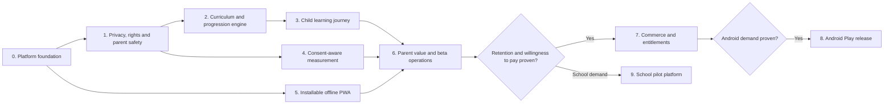

# Milo Phonics — Technical Delivery Backlog

**Current product/architecture source:** [Current Product and Architecture](current-product-and-architecture.md)

**Strategic source:** [Product Roadmap and Android Strategy](product-roadmap-and-android-strategy.md)

**Planning horizon:** Family beta → paid PWA → Android → school pilots

**Backlog convention:** P0 blocks the next release; P1 follows the release gate; P2 is only started when the preceding market signal is met. Estimates are delivery points for planning only: 1 = small, 3 = medium, 5 = large, 8 = needs decomposition.

## Current execution slice

**Completed:** E0.1 — reproducible Node/npm setup; E0.2 — automated quality gates; E0.3 — focused service tests; E0.4 — current product/architecture record.

**Active item:** E1.1 — asset rights register.

**Status:** In progress (13 October 2026). E1.1 now has a repository-grounded register covering all committed audio/video families, referenced-but-missing video paths, inline visuals, fonts, direct libraries, and generation/publishing vendors. The lockfile has a reproducible SPDX command and a dependency notice record; release artifact retention, full licence text, and rights evidence are still missing. E1.2 now has a typed, parent-gated draft covering local storage, Clerk, Google Fonts, bundled audio, OpenAI/Cloudinary generation roles, hosting, Sentry, retention, deletion, transfers, and the missing contact; it is not approved or publicly published. E1.3 now has a technical data-flow inventory reconciled with the E0.7 authored destinations; controller/processor, retention, deletion, transfer, hosting, and vendor evidence remain open. E0.7 remains open for reset and induced audio-failure checks, full network tracing, release metadata verification, and the Clerk production-mode decision. E0.6 remains blocked on authorized privacy/DPA, retention, deletion, and inferred-geography decisions; its evidence is recorded in [the Sentry vendor review](2026-10-13-sentry-vendor-data-flow-review.md), [the privacy-notice draft](../privacy-notice-draft.md), and the [Sentry design](2026-10-13-sentry-react-instrumentation-design.md).

**Next acceptance step:** Retain a generated `sbom.spdx.json` release artifact, attach full licence text, and obtain engineering/release-owner review of non-MIT families. Assign an owner for each open E1.1 evidence row, attach source/licence/contract records, and decide the missing Milo video states. For E1.2/E1.3, supply the real controller contact, complete vendor/retention/deletion/transfer fields, reconcile hosting and SDK records, and approve a public publication location before changing draft statuses. Continue E0.7’s isolated reset/audio-failure and network-trace checks and obtain a production-mode decision for Clerk. The Cloudinary wording finding was corrected in `1661e42` and verified in its Ready deployment. In parallel, obtain authorized privacy-owner review/acceptance of E0.6’s DPA and data-flow terms, approve and publish the parent-facing privacy/retention notice with a real contact, decide the inferred-geography treatment, and clean up the synthetic verification issue under an approved deletion policy.

## Audit integration and release holds

This backlog incorporates the findings of the [pre-marketing content-rights and privacy audit](../audits/pre-marketing-content-rights-privacy-audit-2026-10-13.md). The audit’s P0 findings are delivery work, not documentation-only risks.

Until the relevant stories have passed, pause these external claims: Oxford/Oxford Advanced Learner’s Dictionary, authentic Oxford, pure British/RP, UK National Curriculum, Letters and Sounds or SSP-programme alignment, COPPA compliance, zero child data, 100% client-side privacy, fully offline/PWA, Cloudinary fallback, toddler-tested, safe, mastery, age suitability, and learning-outcome claims. Use only the audit-approved modest description of the product in the meantime.

No broad marketing, paid family launch, school pilot, or Play submission may pass its release gate with an unresolved P0 rights, educational, privacy, or claims-control finding.

## Delivery sequence

## Release milestones

| Milestone | Purpose | Included epics | Exit criteria |
| --- | --- | --- | --- |
| M0 — Trusted beta foundation | Make the product safe, observable, and repeatable for research families. | E0–E2, E5–E6 | No unresolved P0 audit finding; reliable build; PWA works offline; research events are consented and visible to the parent. |
| M1 — Guided beginner beta | Prove a child can progress through a coherent first-learning path. | E3–E4 | 20–30 families complete research; child flow and parent summary work; learning content is reviewed. |
| M2 — Paid family PWA | Validate price, packaging, and renewal value. | E7 plus ongoing E3/E4/E6 | Entitlements are server-verified; purchase and restore work; support and privacy operations exist. |
| M3 — Android closed beta | Validate the same core experience on Android hardware. | E8 | Offline/audio/device test matrix passes; Play Console declarations are complete; closed testing is underway. |
| M4 — School pilot | Prove teacher workflow and home-school use before building a full B2B platform. | E9 | 3–5 pilots run with agreed data processing and useful teacher feedback. |

## E0 — Engineering foundation and release quality

**Goal:** Make the existing React application safe to change and deploy repeatedly.

**Dependencies:** None.

| ID | User story | Priority | Points | Acceptance criteria |
| --- | --- | --- | --- | --- |
| E0.1 | As an engineer, I need a documented supported Node/npm version and repeatable local setup so every contributor builds the same application. | P0 | 1 | `README` and CI use the same supported versions; fresh setup can install, build, and preview without undocumented steps. |
| E0.2 | As an engineer, I need automated type, lint, unit-test, and production-build checks so regressions are caught before deployment. | P0 | 5 | `npm run lint`, `npm test`, and `npm run build` exist; CI runs them on pull requests; failure blocks merge. |
| E0.3 | As an engineer, I need focused tests around progress migration, level unlocking, audio URL resolution, and parental gate rules. | P0 | 5 | Tests cover normal and corrupt local-storage data, legacy migration, no downgrade of stars, asset fallback, and gate success/failure; all run headlessly. |
| E0.4 | As a maintainer, I need a single current product/architecture record so sales, compliance, and engineering decisions use the same facts. | P0 | 3 | Stale claims about browser speech synthesis and Cloudinary-first playback are corrected; implemented/completed roadmap items are marked; one document is named the current roadmap. |
| E0.5 | As a release owner, I need versioned releases and rollback instructions so a bad content or web release can be recovered quickly. | P1 | 3 | Build has an app version; release notes and rollback steps exist; production deployment identifies the serving build. |
| E0.6 | As an engineer, I need structured client error reporting that does not collect child data so we can repair broken sessions. | P1 | 5 | Parent-consented error events exclude free text, audio, identifiers, and child content; error rate dashboard can be queried by release version. |
| E0.7 | As a release owner, I need a repeatable production network and dependency check so repository assumptions are verified against the deployed app. | P0 | 3 | Capture and review first visit, local mode, parent-gate, sign-in/sync, reset, audio failure, and mobile sessions; record all network destinations, headers, cookies/storage, injected scripts, and third-party dependencies. |

**E0.7 evidence:** The 13 October production review is recorded in [the E0.7 network review](2026-10-13-e0-7-production-network-review.md). The safe flow checks passed and the Cloudinary wording mismatch was corrected and verified in deployment `1661e42`; destructive reset, induced audio failure, full network tracing, release metadata verification, and the Clerk production-mode decision remain open.

## E1 — Rights, privacy, and child-safe account foundation

**Goal:** Ensure the product can be distributed and monetised without relying on unverified claims or inappropriate child-data handling.

**Dependencies:** E0.1.

| ID | User story | Priority | Points | Acceptance criteria |
| --- | --- | --- | --- | --- |
| E1.1 | As a release owner, I need an asset rights register so every sound, image, video, font, library, and voice asset has an owner, licence, territory, term, modification right, attribution requirement, and expiry recorded. | P0 | 3 | Register covers all shipped assets; unresolved rights prevent external launch claims and paid distribution; creator/source evidence is retained. |

**E1.1 evidence:** The [asset rights register](../asset-rights-register.md) inventories the current repository and records the unresolved owner-evidence ledger. It is intentionally not marked complete until the rights fields and retained evidence are filled by the responsible owners.

**E1.4 evidence:** The arithmetic gate now uses browser crypto randomness when available, unbiased option shuffling, and an in-memory five-failure/60-second retry window with a 30-second lockout. It protects the existing parent dashboard, Clerk entry point, diagnostics consent, and reset action. No purchase, support, account deletion, or child-facing external-link flow exists yet; each must be routed through the gate before implementation.

**E1.9 evidence:** The parent audio panel and README now disclose that some bundled curriculum voice audio was generated with OpenAI TTS. The disclosure is limited to the evidenced scope; model/voice records, provenance, vendor terms, human acceptance, and distribution-surface review remain open.

**E1.10 evidence:** The [claims register](../claims-register.md) records paused claim families and the approved modest baseline. `npm run verify:claims` scans the checked user-facing surfaces and is part of `npm run build`; external distribution copy and claim-owner approvals remain open.
| E1.2 | As a parent, I need a plain privacy notice so I understand what is stored locally, what leaves the device, and how to ask for deletion. | P0 | 3 | Notice covers LocalStorage and other storage/access technology, Clerk, Google Fonts, Cloudinary, hosting, telemetry, payments, support, retention, international transfers, and parent contact; it is reachable through the parent area and public site. |
| E1.3 | As a privacy owner, I need a data-flow inventory so the Data Safety declaration and privacy notice stay accurate. | P0 | 3 | Inventory lists fields, purpose, controller/processor, subprocessors, storage location, transfer mechanism, security, retention, and deletion path for every SDK/service; it is reconciled with E0.7 before each new vendor. |
| E1.4 | As a child, I need all account, consent, support, and payment actions protected by a robust parent gate. | P0 | 5 | The child experience works with no account; an adult gate protects cloud sync, external links, purchase, account deletion, and consent changes; gate has rate limiting and a non-predictable challenge. The gate is not represented as parental-responsibility verification or a complete legal-consent mechanism. |
| E1.5 | As a parent, I need to export and delete cloud-held family data without contacting support. | P1 | 5 | Adult-authenticated export and deletion work; deletion completes across the product data store and documented processors within the stated retention window. |
| E1.6 | As a compliance owner, I need Clerk, Google Fonts, Cloudinary, hosting, and future SDKs audited before they are enabled or relied on. | P0 | 5 | Written vendor assessment, contract/DPA record, subprocessor/transfer/retention/security review, and configuration decision exists; app does not enable a disallowed SDK for a child/unknown-age session. |
| E1.7 | As a parent, I need a safe support path that never exposes the child to external websites or free-text contact flows. | P1 | 3 | Support and legal links are adult-gated; no child-facing outbound links exist; support requests are associated with a parent only. |
| E1.8 | As a release owner, I need a documented decision on all Oxford recordings and marks so the product neither ships nor markets unlicensed material. | P0 | 5 | Obtain written commercial-content and trademark permission with the required attribution, **or** remove/replace every Oxford label, reference, and affected asset; no external Oxford claim remains without evidence. |
| E1.9 | As a parent, I need clear disclosure when Milo uses AI-generated voice audio. | P0 | 3 | The product and relevant distribution surfaces clearly disclose AI-generated TTS audio; generation records retain model, voice, date, source text, acceptance reviewer, and applicable account/terms record. |
| E1.10 | As a release owner, I need an approved claims register and build check so unsupported claims cannot reappear in code, app-store copy, or marketing pages. | P0 | 5 | Each external claim has evidence, approved wording, owner, review date, and allowed channels; CI/search check flags paused terms; release checklist requires specialist privacy and SSP sign-off where required. |
| E1.11 | As a privacy owner, I need a Children’s Code/DPIA and lawful-basis decision before processing child-linked cloud progress or research data. | P0 | 5 | A qualified UK privacy professional has reviewed the documented purpose, necessity, high-privacy defaults, parental-responsibility approach, storage/PECR position, retention, rights, and mitigations; actions are tracked to closure. |

## E2 — Content platform and curriculum data model

**Goal:** Turn the current content catalogue into a versioned curriculum that can scale beyond CVC without component rewrites.

**Dependencies:** E1.1, E0.3.

| ID | User story | Priority | Points | Acceptance criteria |
| --- | --- | --- | --- | --- |
| E2.1 | As a curriculum author, I need one machine-readable sound-set schema so order, prerequisites, decodable words, review rules, audio assets, content version, and the intended educational scope are defined in data. | P0 | 5 | Schema supports phonemes, graphemes, VC/CVC words, digraphs, reader pages, review items, and content status; UI consumes it without per-screen hard coding; advertised labels are derived from the actual schema. |
| E2.2 | As a curriculum reviewer, I need validation that every published item has working audio, a permitted asset, a taught prerequisite, an accurate word classification, and an approved pronunciation. | P0 | 5 | Validation command fails the build for missing/repeated IDs, missing local assets, invalid prerequisites, an unavailable GPC (for example `bed` before `b`), or a VC item labelled CVC (for example `at`). |
| E2.3 | As a learner, I need progress to distinguish exploration from demonstrated practice so a sound is not unlocked merely because I tapped it several times. | P0 | 5 | Existing stars remain a positive reward; progression uses practice evidence, correct first attempt, and review opportunity; migration preserves existing progress. |
| E2.4 | As a content operator, I need a content-version migration path so new sound sets or changed rules do not strand existing children. | P1 | 3 | Content releases declare their version; progress is migrated or mapped explicitly; regression tests cover upgrade and rollback. |
| E2.5 | As a content author, I need a production checklist for new audio/video so media quality and child-safe pronunciation are consistent. | P1 | 3 | Checklist includes source rights, pronunciation review, loudness, silence trim, local bundle size, offline test, and versioning. |
| E2.6 | As a future localisation owner, I need content metadata separated from UI strings so parent guidance can be translated without changing phonics audio. | P2 | 5 | Parent-facing copy is externalised; locale and British-English phonics content are modelled independently. |
| E2.7 | As a release owner, I need an independent UK SSP review of the actual scope and sequence so learning claims match what Milo delivers. | P1 | 5 | A qualified SSP specialist reviews every recording, sequence, GPC, word, tricky-word treatment, blending/segmenting practice, decodability, assessment/review method, and delivery guidance; public claims are corrected or formally approved. |

## E3 — Guided learning and evidence-based practice experience

**Goal:** Give a 3–5-year-old a coherent path from hearing a sound to blending and reading a controlled text.

**Dependencies:** E2.1–E2.3, E1.4.

| ID | User story | Priority | Points | Acceptance criteria |
| --- | --- | --- | --- | --- |
| E3.1 | As a child, I need a single “next best activity” so I can keep learning without navigating a complex menu. | P0 | 5 | Home screen starts/resumes the appropriate sound or review; all choices are based on published curriculum prerequisites and local progress. |
| E3.2 | As a child, I need each taught sound to move through hear → identify → say/play → blend → revisit, so practice is purposeful. | P0 | 8 | Each core sound set has this complete loop; wrong answers stay supportive and generate a later review, not a penalty. |
| E3.3 | As a child, I need short spaced review sessions so earlier sounds remain available after I unlock new ones. | P0 | 5 | Review scheduling has configurable rules, uses offline local data, limits session length, and never blocks access after a poor response. |
| E3.4 | As a child, I need a first digraph experience so I can learn that two letters may make one sound. | P1 | 5 | `sh`, `ch`, `th`, `ck`, `ng`, and `qu` are represented in the content model; visual, audio, blending, and practice assets pass E2 validation. |
| E3.5 | As a child, I need a three-page decodable micro-reader so I can apply learned sounds in connected text. | P1 | 8 | Every word is verified against taught graphemes plus approved tricky words; sentence and word audio work offline; progress returns to the next recommended practice. |
| E3.6 | As a child, I need an optional discovery mode so younger children can enjoy sounds without being pushed through a reading path. | P1 | 3 | Parent can select the mode; discovery actions do not create misleading progression signals; activity remains fully usable without text. |
| E3.7 | As a product team, we need accessibility and device usability checks so touch, reduced motion, contrast, and audio controls work for the intended families. | P1 | 5 | Keyboard/switch navigation and screen-reader labels pass agreed checks; all primary targets meet the design standard; mute remains persistent and respected. |

## E4 — Parent value, profiles, and controlled cloud sync

**Goal:** Give parents useful, understandable guidance without turning child interactions into a surveillance product.

**Dependencies:** E1.2–E1.6, E2.3, E3.1.

| ID | User story | Priority | Points | Acceptance criteria |
| --- | --- | --- | --- | --- |
| E4.1 | As a parent, I need a weekly summary of sounds practised, blends attempted, and one suggested next activity. | P0 | 5 | Summary is behind the parent gate; labels describe observed practice, not diagnosis; it works from local-only progress. |
| E4.2 | As a family, I need separate child profiles so siblings do not overwrite each other’s learning path. | P1 | 5 | Profiles use parent-selected nicknames or neutral labels; switching is parent-gated; all data remains local until parent opts into backup. |
| E4.3 | As a signed-in parent, I need secure cross-device backup so I can restore family progress without manually copying data. | P1 | 8 | Replace direct use of Clerk `unsafeMetadata` for unbounded product data with a versioned, access-controlled profile store; conflicts are deterministic; delete/export works; controller/processor and parental verification requirements from E1 are met. |
| E4.4 | As a parent, I need clear device/offline status so I understand whether a session and changes have been saved. | P1 | 3 | UI distinguishes local save, pending sync, successful backup, and retry; no child-facing error prompts. |
| E4.5 | As a support owner, I need a parent-only diagnostic export so support can troubleshoot with explicit consent. | P2 | 3 | Export is redacted, time-limited, and generated only after parent confirmation. |

## E5 — Consent-aware product measurement and experiment platform

**Goal:** Learn whether the experience helps and earns, using the minimum data required.

**Dependencies:** E1.2–E1.6, E2.3.

| ID | User story | Priority | Points | Acceptance criteria |
| --- | --- | --- | --- | --- |
| E5.1 | As a product owner, I need a written event taxonomy so every metric has a purpose, owner, field definition, retention limit, and consent requirement. | P0 | 3 | Taxonomy covers activation, practice, return, quality, and purchase; it excludes names, recordings, free text, ad IDs, and persistent device identifiers. |
| E5.2 | As a parent, I need to choose whether product-improvement data leaves the device. | P0 | 5 | Default behaviour matches legal advice; consent is adult-gated, granular, reversible, and visible in the dashboard; events are minimised and pseudonymised rather than assumed anonymous; the app works when declined. |
| E5.3 | As a product analyst, I need activation and retention dashboards so we can decide whether to invest in commerce or Android. | P0 | 5 | Dashboard reports cohort activation, day 1/7/30 family return, session completion, audio failures, and device category without exposing child-level data. |
| E5.4 | As a product owner, I need an experiment mechanism so we can test onboarding and packaging without separate code branches. | P1 | 5 | Experiments are parent-consented where required, assigned safely, logged, reversible, and cannot alter the phonics sequence or child safety rules. |
| E5.5 | As a researcher, I need a consented pilot feedback workflow so observations and parent interviews are linked to product version, not child identity in analytics. | P1 | 3 | Research consent is separate from app analytics; notes live in a restricted research system; findings are tagged by release and theme. |

## E6 — Installable, reliable offline PWA

**Goal:** Make Milo an installable, dependable mobile web app before store distribution.

**Dependencies:** E0.2, E2.2.

| ID | User story | Priority | Points | Acceptance criteria |
| --- | --- | --- | --- | --- |
| E6.1 | As a parent, I need to install Milo from my mobile browser so it is easy to find and opens full-screen. | P0 | 3 | Web manifest, name, theme colour, icons, display mode, and installation guidance meet browser requirements on Android and iOS where supported. |
| E6.2 | As a child, I need every released learning activity to start and finish with no network connection after the first install. | P0 | 8 | Service worker precaches application shell and released media; offline cold-start, audio, video, progress, and game completion tests pass. “Fully offline” and PWA claims remain paused until this evidence exists. |
| E6.3 | As a parent, I need safe updates so new content arrives without corrupting an in-progress session or trapping the family on an old build. | P0 | 5 | Cache uses versioned assets; update prompt is adult-facing or non-disruptive; old cache cleanup is verified; release rollback is documented. |
| E6.4 | As an engineer, I need asset-size and caching budgets so growth in audio/video does not make installation slow or unreliable. | P1 | 3 | CI reports bundle/media sizes; budgets exist for initial install and incremental content packs; assets above budget require a review. |
| E6.5 | As a parent, I need an offline status and recovery path so I understand why content has not downloaded yet. | P1 | 3 | Parent dashboard explains download status and retry; child flow continues with installed content; no technical error is shown to the child. |

## E7 — Family commerce and entitlement platform

**Goal:** Sell access ethically and maintain consistent access across web, PWA, and later Android.

**Dependencies:** E1, E4.2–E4.3, E5.1–E5.3, E6.1–E6.3; retention and price-validation decision gate.

| ID | User story | Priority | Points | Acceptance criteria |
| --- | --- | --- | --- | --- |
| E7.1 | As a parent, I need to see a clear adult-only offer so I understand free content, paid benefits, price, renewal, and cancellation before purchase. | P0 | 5 | Purchase screen is behind the parent gate; terms and privacy links are available; no child receives a purchase prompt; offer copy is versioned. |
| E7.2 | As a parent, I need to purchase the family plan and receive access immediately and reliably. | P0 | 8 | Payment provider checkout is adult-authenticated; backend validates transactions and grants a server-side entitlement; success/failure/retry are handled. |
| E7.3 | As a parent, I need to restore my entitlement when I move device or reinstall. | P0 | 5 | Restore works from parent account; expiry, refund, and cancellation are correctly reflected; support can view a minimal auditable history. |
| E7.4 | As a finance owner, I need accurate revenue and entitlement reconciliation so access never depends solely on the browser. | P1 | 5 | Webhooks are verified; failed payments and refunds update entitlement; reconciliation report identifies mismatches. |
| E7.5 | As a parent, I need to cancel or manage renewal without a hidden process. | P0 | 3 | Web purchase has a clear management path; later store purchases deep-link to the appropriate store management surface. |
| E7.6 | As a product owner, I need paywall tests that do not pressure children or reduce access for research cohorts. | P1 | 3 | Tests are adult-only, gated by E5 consent rules, and report conversion/refund results by offer version. |

## E8 — Android via Capacitor and Google Play release

**Goal:** Deliver a native-distributed Android version that is meaningfully offline, reliable, and compliant for families.

**Dependencies:** E6 complete; E1.2–E1.6; Android decision gate; E7 for a paid Android offer.

| ID | User story | Priority | Points | Acceptance criteria |
| --- | --- | --- | --- | --- |
| E8.1 | As an engineer, I need a Capacitor Android project so the existing React bundle can run from local app assets. | P0 | 3 | Capacitor config, app ID, Android project, Gradle configuration, and signed debug build are reproducible; no remote website is the app shell. |
| E8.2 | As a child, I need the app to resume safely after backgrounding, a call, Bluetooth change, or accidental repeated taps. | P0 | 8 | Audio focus/lifecycle tests cover interruption, resume, mute, current blend cancellation, and no stuck busy state on supported devices. |
| E8.3 | As a child, I need navigation to feel native and safe on a phone or tablet. | P0 | 5 | Android Back behaviour is defined per screen; rotation, safe areas, font scaling, full-screen mode, and low-memory recovery pass device tests. |
| E8.4 | As a parent, I need downloads and progress to work offline in the installed Android app. | P0 | 5 | Offline first launch after installation, later cold start, cache update, local profile switch, and parent backup retry pass in the Android test matrix. |
| E8.5 | As a release owner, I need Android package identity, signing, and secure build secrets managed outside source control. | P0 | 3 | Release signing key process, package name, CI secrets, Android App Bundle build, and recovery owner are documented. |
| E8.6 | As a product owner, I need store listing assets and a truthful declaration package so Play review can assess the app. | P0 | 5 | Listing, age target, IARC questionnaire, privacy-policy link, Data Safety declaration, Families policy checklist, AI-audio disclosure, and test credentials are reviewed against the claims register and shipped SDKs. |
| E8.7 | As a developer with a new personal Play account, I need a closed testing plan so production access is not delayed after build completion. | P0 | 3 | At least 12 testers are recruited, opted in continuously for the required 14 days, receive a test script, and feedback/release fixes are recorded. |
| E8.8 | As a paid Android customer, I need Play purchase and restore to work across app updates and account changes. | P1 | 8 | Google Play Billing uses server verification; entitlement model is shared with web; subscription management and cancellation paths are implemented. |
| E8.9 | As an operations owner, I need crash/ANR and audio quality monitoring for Android releases. | P1 | 5 | Play Console and consent-safe error monitoring are reviewed after staged release; crash-free target and rollback threshold are defined. |

## E9 — School pilot platform

**Goal:** Test a lightweight teacher workflow before committing to institutional scale.

**Dependencies:** E1, E2–E5, three qualified pilot partners.

| ID | User story | Priority | Points | Acceptance criteria |
| --- | --- | --- | --- | --- |
| E9.1 | As a school administrator, I need a classroom set-up flow that does not require children to create accounts. | P1 | 5 | Teacher creates a class through an adult account; child identifiers are pseudonymous or local by default; roles and access are documented. |
| E9.2 | As a teacher, I need to assign a sound set and share the equivalent home practice. | P1 | 5 | Teacher selects only published curriculum content; a parent-safe QR/link opens the correct set; no child contact data is embedded. |
| E9.3 | As a teacher, I need a simple aggregate view so I can see who may need another opportunity to practise. | P1 | 5 | View shows observed completion/practice only, not diagnostic attainment; personal data access follows the pilot data agreement. |
| E9.4 | As a pilot owner, I need consent, data-processing, and school data deletion workflows before onboarding a class. | P0 | 5 | Agreement, controller/processor roles, retention, export/deletion path, incident contact, and pilot end procedure are approved. |
| E9.5 | As a classroom facilitator, I need a large-screen mode that works on an interactive board without exposing family or account information. | P2 | 5 | Classroom mode is separate from profiles, has suitable scale/input behaviour, and runs with no child account data on display. |
| E9.6 | As a school buyer, I need an organisation-level entitlement and invoice workflow. | P2 | 8 | Licensing, seats/classes, renewal, administrator transfer, invoice/PO support, and permissions are defined after pilot evidence supports the pricing model. |

## E10 — Content expansion and future capability

**Goal:** Extend learning depth only after the beginner path, retention, and quality foundation have been proven.

**Dependencies:** E2–E3 complete; curriculum advisory approval; evidence from beta/pilots.

| ID | User story | Priority | Points | Acceptance criteria |
| --- | --- | --- | --- | --- |
| E10.1 | As an EAL learner, I need visual articulation support for commonly confused British-English sounds. | P2 | 8 | Adviser-reviewed mouth/illustration assets, clear sound pairs, parent guidance, and rights approval are complete. |
| E10.2 | As a child, I need minimal-pair listening practice that stays playful and never labels a mistake as failure. | P2 | 5 | Pairs are curriculum-reviewed; incorrect choices create review opportunities; no score/life loss is used. |
| E10.3 | As a child, I need tactile grapheme tracing that teaches correct formation without punishing motor development. | P2 | 8 | Input model works on touch devices; formation rules are curriculum-reviewed; accessibility fallback is available. |
| E10.4 | As a parent, I need translated setup and guidance that helps me support British phonics even if English is not my first language. | P2 | 5 | Translations are professionally reviewed; child phonics audio remains British-English; language selection is parent-gated. |
| E10.5 | As a content team, we need themed sound worlds only when they support a measurable learning purpose. | P2 | 5 | Each world maps to a sound/review objective, has asset rights, runs offline within budget, and is evaluated against retention rather than novelty alone. |

## Cross-epic non-functional requirements

| Area | Requirement |
| --- | --- |
| Privacy | Core child use requires no account, ads, microphone, location, camera, advertising ID, or child-created public content. |
| Safety | Purchases, support, outbound links, consent, data export/delete, and account changes are adult-gated. |
| Offline | All released child activities must complete after initial installation with no network. |
| Performance | The first meaningful child interaction must be responsive on the lowest supported device; audio starts reliably after a child gesture. |
| Accessibility | Maintain large touch targets, contrast, reduced-motion respect, usable text scaling, keyboard/switch support, and labelled controls. |
| Data quality | Progress, curriculum, assets, and entitlements are versioned and migratable. |
| Observability | Errors and product events are minimal, consent-aware, release-versioned, and never contain child free text/audio. |
| Quality assurance | Every release has automated checks, exploratory child-device testing, offline testing, and a rollback plan. |
| Claims governance | Marketing, app-store, README, and in-app statements must be traceable to reviewed evidence; absolute privacy, safety, accreditation, age, outcome, accent, provenance, and offline claims require explicit approval. |

## Backlog ordering for the next three implementation cycles

### Cycle 1 — Foundation

1. E0.1–E0.4
2. E0.7
3. E1.1–E1.4 and E1.6, E1.8–E1.11
4. E2.1–E2.3
5. E5.1–E5.2
6. E6.1

### Cycle 2 — PWA and guided beta

1. E6.2–E6.3
2. E3.1–E3.3
3. E4.1
4. E5.3 and E5.5
5. E0.5–E0.6 and E2.7

### Cycle 3 — Validate commercial path

1. Run the 20–30 family beta and assess M1 exit criteria.
2. If retention and willingness to pay are validated: E4.2–E4.4 and E7.1–E7.5.
3. If schools are the stronger validated channel: E9.1–E9.4 before E7.
4. Start E8 only when the Android decision gate in the product roadmap is met.

## Explicitly deferred

Do not schedule these before M1 evidence exists: broad paid acquisition, full teacher analytics, multi-touch classroom boards, broad localisation, microphone-based speech analysis, advertising, social features, and a React Native rewrite. They increase technical and compliance cost without solving the immediate validation problem.
